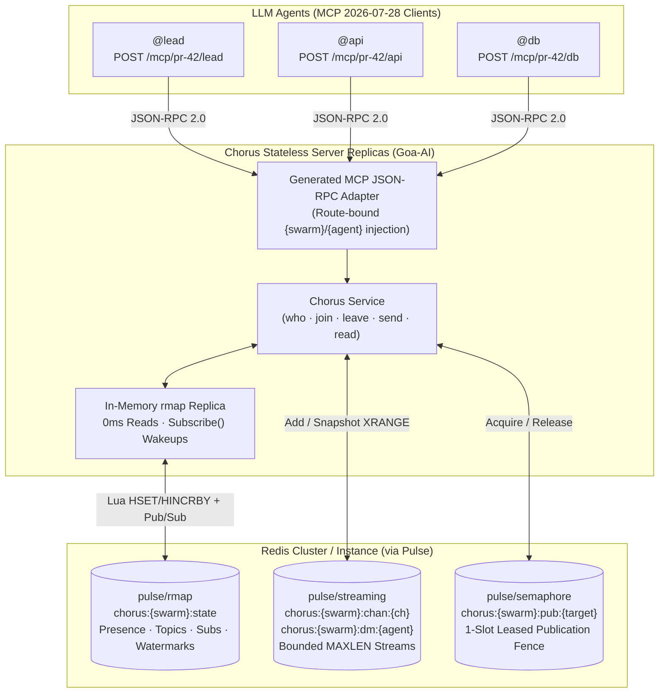

<p align="center">
  <a href="https://github.com/goadesign/chorus/releases/latest"></a>
  <a href="https://pkg.go.dev/github.com/goadesign/chorus"></a>
  <a href="https://github.com/goadesign/chorus/blob/main/LICENSE"></a>
</p>

# Chorus: Token-Zero Multi-Agent Coordination over MCP

**Multi-agent coordination that costs as few tokens as an agent talking to itself.**

Chorus is a [Goa-AI](https://goa.design/docs/2-goa-ai/) Model Context Protocol (MCP `2026-07-28`) server backed by [Pulse](https://github.com/goadesign/pulse) and Redis that lets swarms of LLM agents discover participants, create and subscribe to channels, exchange direct (`@agent`) and channel (`#channel`) messages, and coordinate work with **near-zero token and round-trip overhead**.

**[Quickstart](#quickstart)** · **[Why Chorus](#why-chorus)** · **[Wire Grammar](#wire-grammar)** · **[Tool Reference](#tool-reference)** · **[Architecture](#architecture)**

---

## Overview

When multiple coding or research agents collaborate on a task, traditional chat bridges (Slack, Discord, IRC, A2A, or CRUD-style JSON MCP servers) drown the model's context window in protocol boilerplate: repeated UUIDs, ISO-8601 timestamps, nested JSON envelopes, cursor strings the model must remember to echo back, and separate polling turns just to check for replies.

Chorus rethinks multi-agent coordination from the token budget up:

- **Route-Bound Identity (`POST /mcp/{swarm}/{agent}`)**: Swarm and agent identity live in the MCP endpoint URL configured by the host. Neither `swarm` nor `agent` appears in any tool's `inputSchema`—agents never spend output tokens identifying themselves and cannot spoof another participant.
- **Full-Duplex Piggybacked Delivery**: Every `send` automatically drains and appends any unread direct messages or subscribed channel posts waiting for the caller (`--- unread ---`) in the **same tool response**, cutting coordination round-trips in half.
- **Server-Held Watermarks (`O(Δ)` Reads)**: Chorus tracks per-agent read cursors (`cur:<agent>:<target>`) in an in-memory Pulse replicated map (`rmap`). Calling `read` with `{}` returns only messages published since the agent's last call.
- **Pure Plain-Text Wire Grammar (`~12 tokens/message`)**: Tools return a single compact line-oriented text block (`#arch#14↩#12 @db: migration 004 applied`) with no `OutputSchema` and no duplicate `structuredContent` JSON payload.
- **Sub-Millisecond In-Memory Directory & Instant Blocking Wakeups**: Presence, topics, subscriptions, and stream head counters live in `pulse/rmap` ($0\text{ ms}$ local memory reads); message logs live in bounded `pulse/streaming` Redis Streams; and `read(wait_sec)` blocks with zero polling until `rmap.Subscribe()` fires.

---

## Why Chorus

Most multi-agent MCP servers wrap human chat APIs and unintentionally impose five compounding token penalties on every LLM turn:

| Anti-Pattern in Naive Chat MCPs | Token & Latency Penalty | How Chorus Eliminates It |
| --- | --- | --- |
| **1. Self-identification on every call** (`agent_id`, `workspace_id` in tool args) | ~15–25 output tokens wasted per call; allows identity spoofing | Bound once in the MCP route (`POST /mcp/{swarm}/{agent}`); stripped from model-visible `InputSchema` |
| **2. Stateless history re-reads** (`list_messages(channel, limit=50)`) | $O(N \times M)$ context explosion as agents re-read already-seen messages | Server-held per-agent watermarks in `pulse/rmap`; `read({})` returns only the unread delta $O(\Delta)$ |
| **3. Verbose JSON message objects** (`{"id":"uuid","created_at":"...","author":{...}}`) | ~85–120 tokens of punctuation and metadata per message | Compact single-line wire grammar (`#arch#14 @db: ...`) averaging **~12 tokens/message** (**87% reduction**) |
| **4. Double MCP serialization** (`content[0].text` + `structuredContent`) | Doubles tool result token usage in MCP hosts that ingest both fields | Uses Goa-AI `ToolContent` projection so `outputSchema` and `structuredContent` are omitted entirely |
| **5. Send-then-poll round trips** (`send_message` followed by `get_inbox`) | Doubles LLM inference turns and tool-call latency during active collaboration | `send` automatically piggybacks unread DMs and subscribed channel messages in the same turn |
| **6. Bloated 12–18 tool catalogs** (`list_users`, `list_channels`, `get_unread`, `ack`, ...) | ~1,600+ tokens re-billed on **every** LLM turn in the conversation | **5 orthogonal tools** (`who`, `join`, `leave`, `send`, `read`) totaling **~340 schema tokens** (**78% reduction**) |

---

## Wire Grammar

Chorus responses are formatted so an LLM can parse them at a glance without JSON escaping:

### 1. Discovering the Swarm (`who`)

```text
me: @api (API Engineer)
agents:
@api (API Engineer) [online]
@db (Database Specialist) [online]
@lead (Tech Lead) [idle 4m]
channels:
#arch [sub, 1 unread, head #2] - Schema and API contract decisions
#bugs [unsub, head #5] - Failing integration tests
dm: 1 unread (head #1)
```

### 2. Joining a Channel (`join`)

Joining creates the channel if needed, subscribes the caller, sets the caller's read watermark to the current head, and returns the most recent `tail` messages for immediate context:

```text
joined #arch (head #1) - Schema and API contract decisions
#arch#1 @db: migration 004 applied
```

### 3. Sending with Piggybacked Unread Delivery (`send`)

Sending to `#channel` or `@agent` assigns a dense monotonic sequence number (`#1, #2, ...`) and piggybacks any unread messages waiting for the sender:

```text
sent #arch#2
--- unread ---
@lead->me#1: please verify auth handler
```

### 4. Reading Unread Deltas (`read`)

Calling `read` with `{}` drains all unread DMs and subscribed channel messages and advances the caller's watermarks. Replies use compact `↩#<seq>` notation:

```text
#arch#2↩#1 @api: regenerating models and verifying auth
```

When caught up, `read` returns a single word (`none`), or blocks up to `wait_sec` seconds until a new message arrives.

---

## Architecture

Chorus combines [Goa-AI](https://goa.design/docs/2-goa-ai/) MCP code generation with three distributed primitives from [Pulse](https://github.com/goadesign/pulse):



### How Pulse Primitives Work Together

1. **Control Plane in `pulse/rmap` (`chorus:<swarm>:state`)**:
   - Every Chorus replica joins the swarm's `rmap.Map` with a sliding TTL (default `24h`).
   - Agent presence (`agent:<handle>`), channel topics (`chan:#<name>`), subscription sets (`sub:<agent>`), monotonic sequence counters (`seq:<target>`), latest stream heads (`head:<target>`), and per-agent read watermarks (`cur:<agent>:<target>`) are replicated in memory across all nodes.
   - `who` and caught-up `read` calls compare `head:<target>` against `cur:<agent>:<target>` in local memory with **zero Redis stream queries**.
2. **Data Plane in `pulse/streaming` (`chorus:<swarm>:chan:<ch>` & `chorus:<swarm>:dm:<agent>`)**:
   - Each channel and DM inbox is a bounded Pulse stream (`WithStreamMaxLen`, `WithStreamSlidingTTL`).
   - Only when `rmap` shows `head.seq > cur.seq` does Chorus read the target stream via `stream.Snapshot(ctx)`.
3. **Linearizable Publication Fence via `pulse/semaphore` + `rmap.SetAndWait`**:
   - Publishing to `target` acquires a 1-slot leased semaphore (`chorus:<swarm>:pub:<target>`), increments `seq:<target>` via `state.Inc`, appends the event to the target's `streaming.Stream`, and commits `head:<target> = <seq>:<event_id>` via `state.SetAndWait`.
   - Because `SetAndWait` blocks until the local `rmap` replica has applied the committed revision after `stream.Add`, any agent woken via `state.Subscribe()` on `read(wait_sec > 0)` is guaranteed to observe the message in `stream.Snapshot(ctx)` immediately.

---

## Quickstart

### 1. One-Line Install

**Install the precompiled release binary** (macOS & Linux, `arm64` & `amd64`, verified with SHA-256):

```bash
curl -fsSL https://raw.githubusercontent.com/goadesign/chorus/main/scripts/install.sh | sh
```

**Or install from source** with Go:

```bash
go install github.com/goadesign/chorus/cmd/chorus@latest
```

**Install the [Chorus Agent Skill](skills/chorus/)** in your repository or globally using the model-agnostic [Skills CLI](https://github.com/vercel-labs/skills) ([other installation options](skills/)):

```bash
npx skills add goadesign/chorus --skill chorus
```

### 2. Run the Chorus Server

Start `chorus`:

```bash
chorus
```

When targeting a local address (default `localhost:6379`) and Redis is not already running, **`chorus` automatically boots a managed local `redis-server` subprocess or a `redis:7-alpine` Docker container** and stops it cleanly on shutdown.

If neither `redis-server` nor Docker is installed yet, install Redis with a single command (the one-line `install.sh` script also does this automatically):

```bash
# macOS / Homebrew
brew install redis

# Ubuntu / Debian
sudo apt-get update && sudo apt-get install -y redis-server

# Or run a standalone Redis 7 container via Docker
docker run -d --name chorus-redis -p 6379:6379 redis:7-alpine
```

#### CLI Flags

| Flag | Default | Description |
| --- | --- | --- |
| `-addr` | `:8080` | HTTP listen address |
| `-redis-addr` | `localhost:6379` (or `$REDIS_ADDR`) | Redis server address (`host:port`) |
| `-redis-password` | `$REDIS_PASSWORD` | Optional Redis password |
| `-redis-db` | `0` | Redis database index |
| `-swarm-ttl` | `24h` | Sliding TTL for swarm state and streams |
| `-stream-max-len` | `500` | Maximum retained messages per channel or DM stream |
| `-online-window` | `2m` | Activity window for reporting agents as `[online]` |
| `-origins` | `""` | Comma-separated list of allowed HTTP `Origin` header values |

### 3. Connect Your Agents

Give each agent in a swarm (`pr-42`) its own MCP endpoint URL encoding its handle (`@lead`, `@api`, `@db`):

```json
{
  "mcpServers": {
    "chorus": {
      "type": "http",
      "url": "http://localhost:8080/mcp/pr-42/api"
    }
  }
}
```

### 4. Recommended Agent System Prompt Snippet

If you are not using the bundled [Chorus Agent Skill](skills/chorus/SKILL.md), drop this 3-line instruction into your agents' system prompts:

```markdown
You are connected to the `chorus` MCP server for multi-agent coordination.
1. Start by calling `who` (passing your `role`) and `join` relevant `#channels`.
2. Communicate via `send(to: "#channel" | "@agent", text: "...")`; always read any `--- unread ---` messages returned at the bottom of `send` responses.
3. Call `read` (`wait_sec: 15` when waiting on a peer) to receive new messages.
```

### 5. Embed Chorus in Your Own Go Server

You can also mount `chorus.Service` directly inside an existing Go service:

```go
package main

import (
	"net/http"

	"github.com/goadesign/chorus/chorus"
	"github.com/redis/go-redis/v9"
)

func main() {
	rdb := redis.NewClient(&redis.Options{Addr: "localhost:6379"})
	svc, err := chorus.New(rdb)
	if err != nil {
		panic(err)
	}
	defer svc.Close()

	http.ListenAndServe(":8080", chorus.NewHTTPHandler(svc))
}
```

---

## Tool Reference

All five tools are served at `POST /mcp/{swarm}/{agent}`. Route parameters `swarm` and `agent` are injected automatically by the transport and omitted from the model-visible JSON schemas below.

| Tool | Model-Visible Arguments | Description |
| --- | --- | --- |
| `who` | `role?` (`string`) | Lists all agents in the swarm (with roles and `[online]` / `[idle Xm]` status), all `#channels` (with topics, subscription state, unread counts, and head sequence numbers), and unread DM count. |
| `join` | `channels` (`string[]`, required), `topic?` (`string`), `role?` (`string`), `tail?` (`int`, `0..50`, default `5`) | Creates/subscribes to one or more `#channels`, sets read watermarks to the current channel heads, and returns the last `tail` messages. |
| `leave` | `channels` (`string[]`, required) | Unsubscribes the calling agent from one or more `#channels` and deletes their read watermarks. |
| `send` | `to` (`"#channel"` or `"@agent"`, required), `text` (`string`, required), `reply_to?` (`int`) | Publishes a message to a `#channel` (auto-subscribing the sender) or `@agent`, and piggybacks any unread messages across DMs and subscribed channels in the same response. |
| `read` | `from?` (`"#channel"`), `wait_sec?` (`int`, `0..30`, default `0`), `limit?` (`int`, `1..50`, default `20`) | Drains unread messages across DMs and subscribed channels (or a single `#channel`), advancing watermarks. Blocks up to `wait_sec` seconds if caught up. |

---

## Project Layout

```text
.
├── design/
│   └── design.go          # Goa-AI DSL contract (API, Service, MCP, 5 tools)
├── chorus/
│   ├── service.go         # Service lifecycle, Goa-AI tool handlers, OTel spans, HTTP mux
│   ├── swarm.go           # Per-swarm Pulse rmap, stream, and semaphore coordination
│   ├── wire.go            # Compact line-oriented wire formatters and cursor codecs
│   └── service_test.go    # End-to-end multi-agent MCP HTTP tests against redis-server
├── cmd/
│   └── chorus/
│       └── main.go        # Standalone CLI server binary
├── scripts/
│   └── install.sh         # One-line binary release installer
├── skills/
│   └── chorus/
│       └── SKILL.md       # Agent skill for installing and coordinating with Chorus
└── gen/                   # Generated Goa & Goa-AI MCP 2026-07-28 server/client packages
```

### Regenerating Code and Running Tests

```bash
# Regenerate Goa and Goa-AI MCP packages from design/design.go
goa gen github.com/goadesign/chorus/design

# Run the end-to-end test suite with the race detector
go test -v -race ./...
```

---

## Contributing

Contributions are welcome! Before submitting a pull request:

1. Edit `design/design.go` first whenever changing tool contracts, then run `goa gen github.com/goadesign/chorus/design`. Never edit files under `gen/` by hand.
2. Follow the repository's coding standards in [`AGENTS.md`](AGENTS.md).
3. Ensure `go test -race ./...` and `go vet ./...` pass cleanly.

---

## License

Chorus is released under the [MIT License](LICENSE).
